# Akatsuki Media

## Descripción del proyecto

Akatsuki Media es un proyecto que le permite a los usuarios registrar y llevar un manejo de su colección multimedia, la cual puede incluir **animes, películas, series, mangas, libros, canciones y álbumes**.

### Colección
Le permite agregar nuevos elementos, eliminar los que tenga y editarlos. De cada elemento se guarda su título, tipo, género, año, creador (director, autor o artista), estado y calificación. Además, a cada elemento le puede subir su portada (JPG o PNG de máximo 2 MB) y, en caso de no tener portada, se le asigna una por defecto; al dar clic sobre la portada se puede ver en grande.

Puede calificar cada elemento de su colección con hasta 5 estrellas y marcar en qué estado va: **pendiente, en proceso, completado o abandonado**. También puede buscar elementos por título, género, creador o año, y filtrarlos por tipo.

### Préstamos
Le permite gestionar qué elementos presta y a quién, la fecha en que los prestó y establecer una fecha de devolución, la cual se puede cambiar después. Cuando el elemento es devuelto lo puede marcar como devuelto para que desaparezca de los préstamos activos. Los préstamos se pueden buscar por el elemento o por la persona a la que se le prestó.

### Listas personalizadas
Aparte de esto, puede crear sus propias listas personalizadas, con su propia portada o una por defecto, en las cuales puede agregar múltiples elementos a la vez, de cualquier tipo. Luego las puede editar (nombre, descripción y portada), añadirles o quitarles elementos, o eliminarlas. Las listas se pueden buscar por su nombre o descripción.

### Estadísticas
Finalmente, puede acceder a las estadísticas de su colección, donde podrá ver datos como:
- El total de elementos de la colección, los préstamos activos, las listas creadas y la calificación promedio.
- La distribución de la colección por tipo.
- Cuántos elementos tiene en cada estado de consumo.
- Los 3 géneros con más elementos (y los demás géneros en un desplegable).
- Los 5 elementos mejor calificados.

Toda la información se guarda en archivos `.txt` separados por `|`, así que no se pierde al cerrar la aplicación. Al eliminar un elemento también se borran su portada, sus préstamos y su registro dentro de las listas.

## Cómo ejecutar el proyecto

### Requisitos
- **Java 25** (JDK). Se puede revisar la versión instalada con `java -version`.
- **Git**, para clonar el repositorio.
- No hace falta instalar Maven, el proyecto ya trae el Maven Wrapper (`mvnw`).
- La primera vez se necesita internet, para descargar las dependencias de Spring Boot y Vaadin.

### Pasos
1. Clonar el repositorio:
   ```bash
   git clone https://github.com/pabloparejaduque0502-png/Coleccion-multimedia.git
   ```
2. Entrar a la carpeta de la aplicación (la que tiene el `pom.xml`):
   ```bash
   cd Coleccion-multimedia/coleccion-multimedia
   ```
3. Ejecutar el proyecto:
   - En Windows:
     ```powershell
     .\mvnw.cmd spring-boot:run
     ```
   - En Linux o Mac:
     ```bash
     ./mvnw spring-boot:run
     ```
4. Esperar a que termine de cargar (la primera vez se demora unos minutos porque descarga todo). El navegador se abre solo; si no se abre, entrar a [http://localhost:8080](http://localhost:8080).
5. Para detener la aplicación, presionar `Ctrl + C` en la terminal.

### Desde VS Code
1. Instalar las extensiones **Extension Pack for Java** y **Spring Boot Extension Pack**.
2. Abrir en VS Code la carpeta `coleccion-multimedia` (la que tiene el `pom.xml`).
3. Abrir `ColeccionMultimediaApplication.java` y dar clic en **Run** encima del método `main`.

> **Importante:** el proyecto se debe ejecutar desde la carpeta `coleccion-multimedia`, porque ahí están los archivos `elementos.txt`, `prestamos.txt`, `listas.txt` y la carpeta `portadas`. Si se ejecuta desde otra carpeta, la aplicación no encuentra los datos de ejemplo y arranca vacía.

## Manual de uso

En la parte de arriba está el menú para moverse entre las 4 vistas: **Mi colección**, **Préstamos**, **Listas** y **Estadísticas**. La aplicación ya trae datos de ejemplo (9 elementos, 3 préstamos y 2 listas) para poder probar todo desde el inicio.

### 1. Mi colección
Es la vista principal, donde se ven todos los elementos en tarjetas con su portada, su título y su calificación en estrellas.

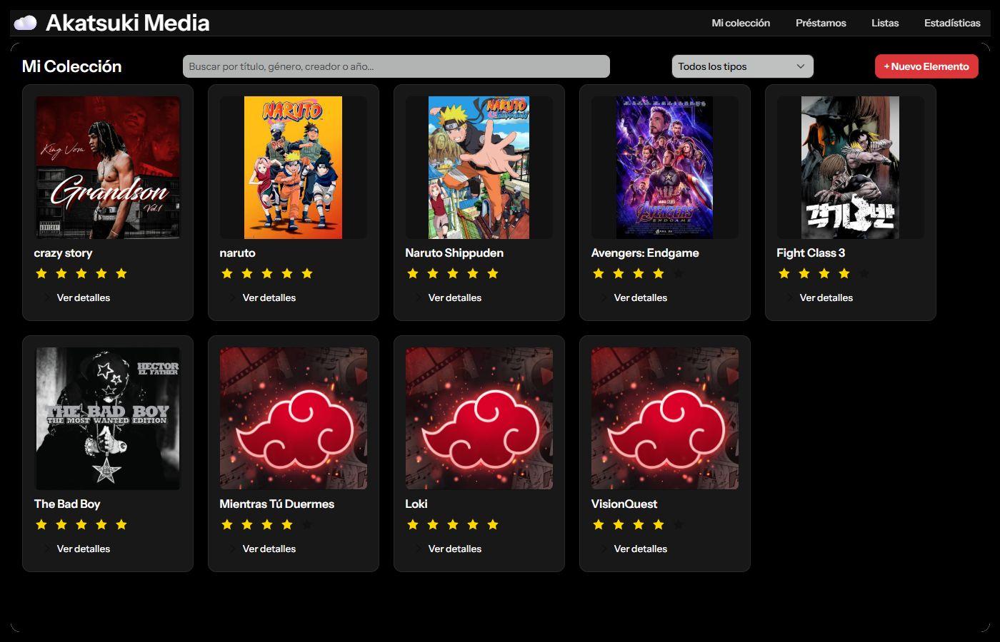

**Agregar un elemento**
1. Dar clic en **+ Nuevo Elemento**.
2. Llenar el título, tipo, género, año, creador y estado. En el género se puede escoger uno que ya exista o escribir uno nuevo.
3. Dar clic en las estrellas para ponerle la calificación.
4. (Opcional) Subir la portada con **Upload File...** o arrastrando la imagen. Si no se sube ninguna, se le pone la portada por defecto.
5. Dar clic en **Guardar**.

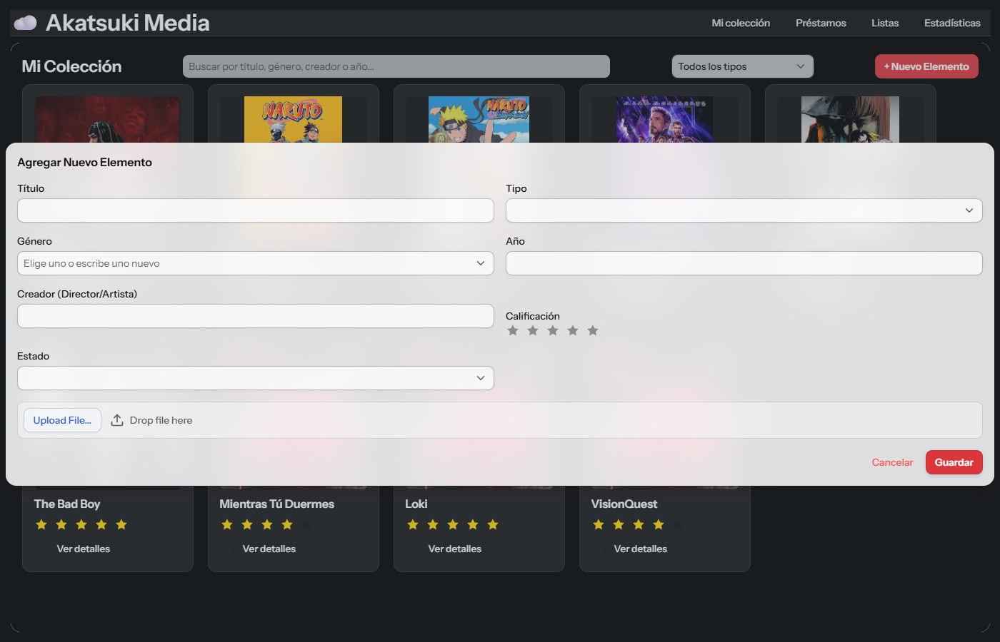

**Ver detalles, editar y eliminar**
- En cada tarjeta, al dar clic en **Ver detalles** se despliega el tipo, género, creador, año y estado, junto con los botones **Editar** y **Eliminar**.
- **Editar** abre el mismo formulario con los datos ya llenos, para cambiar lo que se necesite.
- **Eliminar** pide confirmación antes de borrar. Al eliminar un elemento también se borra su portada, sus préstamos y se quita de las listas donde estaba.

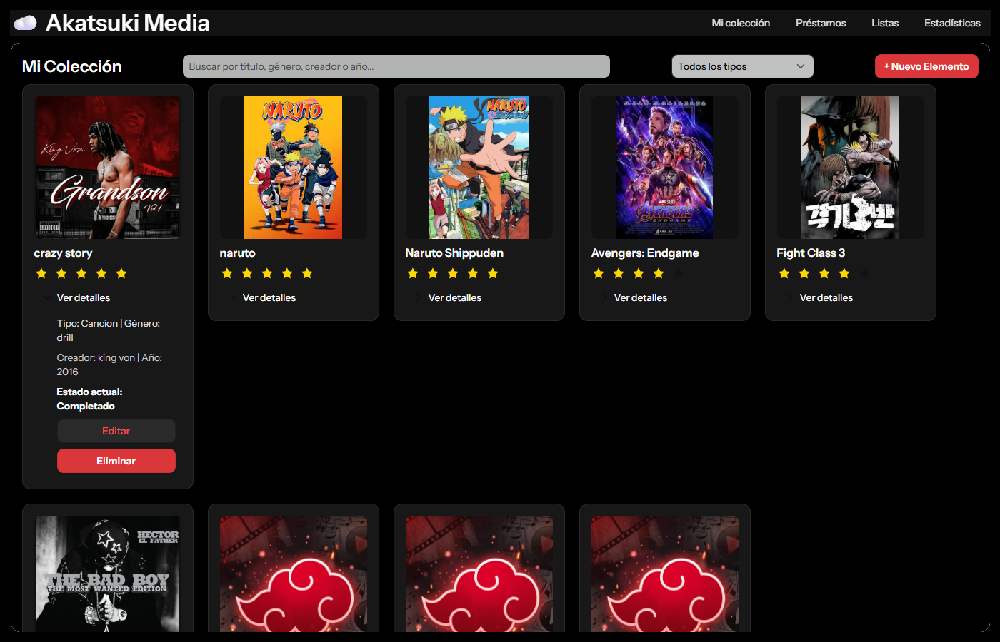
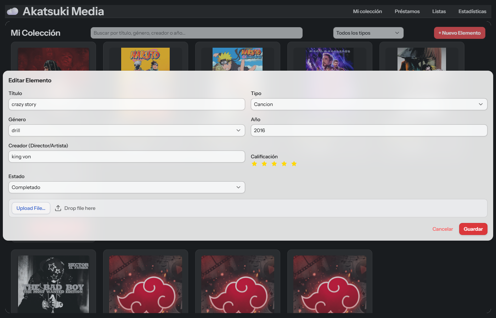

**Ver la portada en grande**
Al dar clic sobre la portada de cualquier tarjeta se abre en grande.

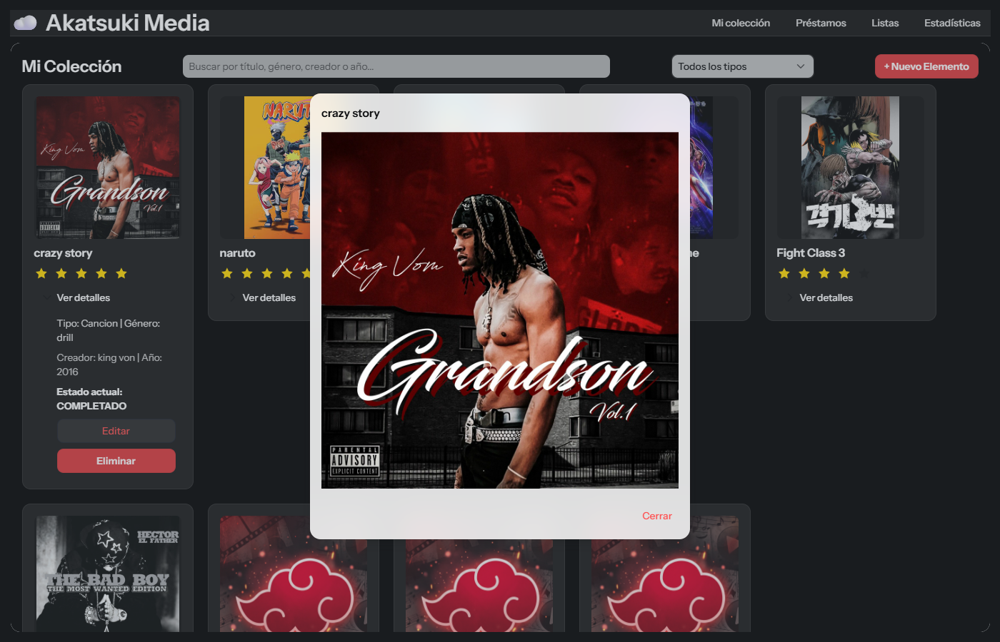

**Buscar y filtrar**
- En la barra de búsqueda se puede escribir el título, género, creador o año, y las tarjetas se filtran mientras se escribe.
- En el selector **Todos los tipos** se puede escoger un tipo (por ejemplo Anime) para ver solo esos elementos.

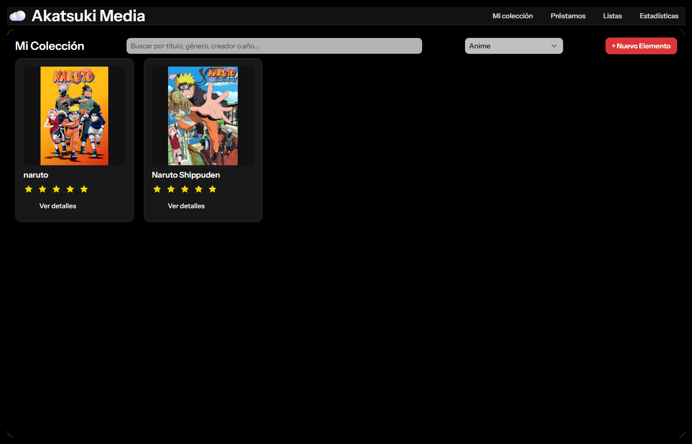

### 2. Préstamos
Aquí se ven los elementos que están prestados.

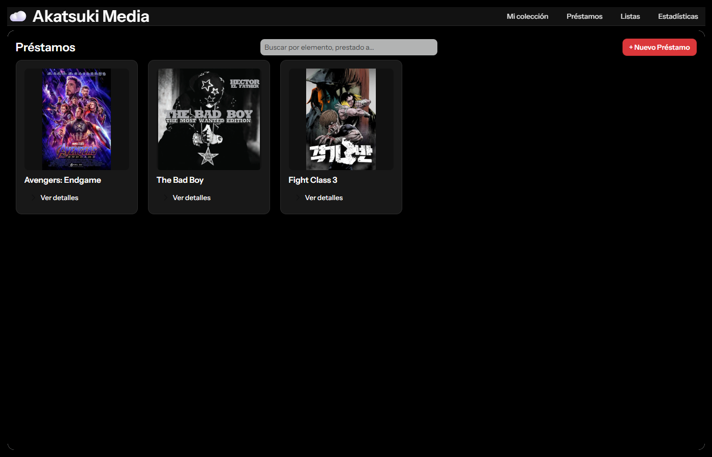

**Registrar un préstamo**
1. Dar clic en **+ Nuevo Préstamo**.
2. Escoger el elemento, escribir a quién se le prestó y la fecha del préstamo (por defecto sale la fecha de hoy).
3. (Opcional) Poner la fecha acordada de devolución.
4. Dar clic en **Guardar**.

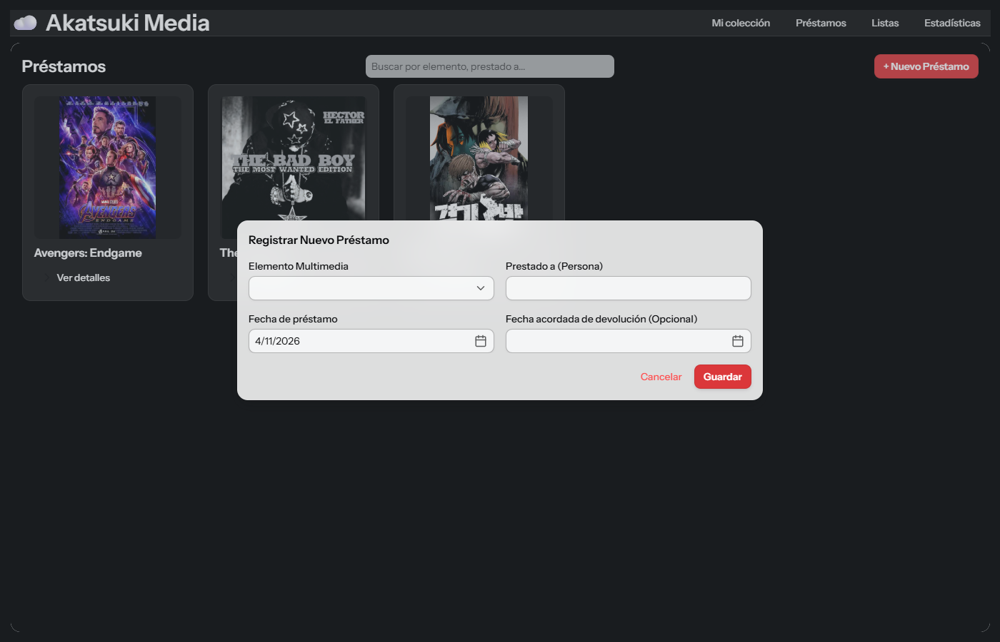

**Cambiar la fecha o marcar como devuelto**
- En **Ver detalles** se ve a quién se le prestó, la fecha del préstamo y la fecha de devolución.
- **Cambiar Fecha de Devolución** permite poner una fecha nueva.
- **Marcar Devuelto** pide confirmación y quita el préstamo de la lista.

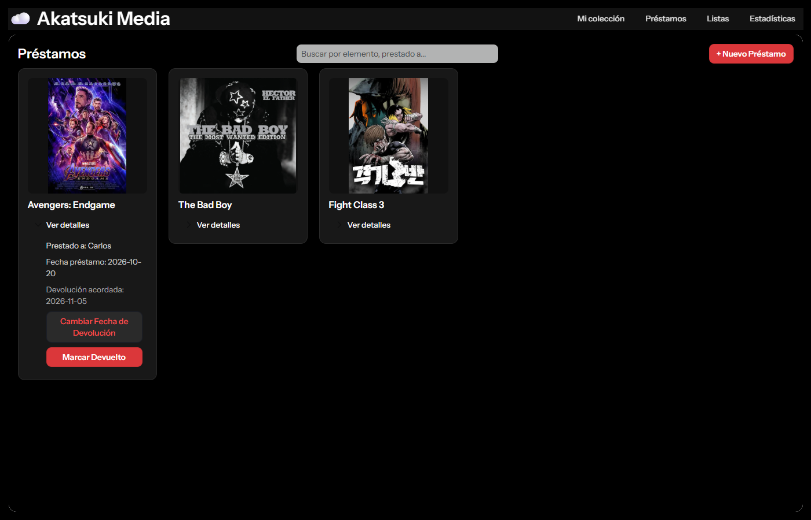
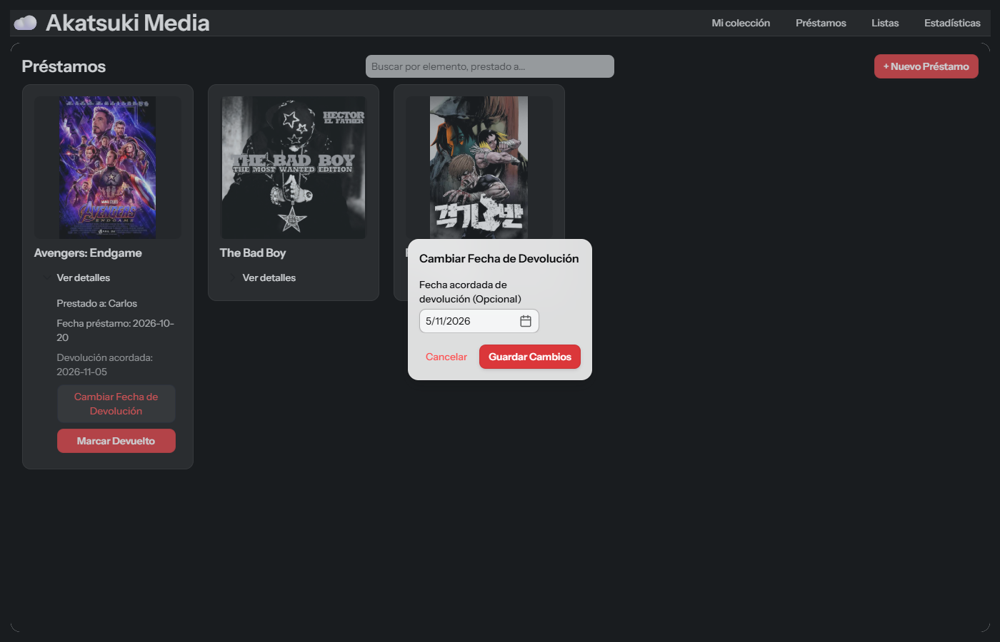

### 3. Listas
Aquí se ven las listas personalizadas con su portada, nombre y descripción.

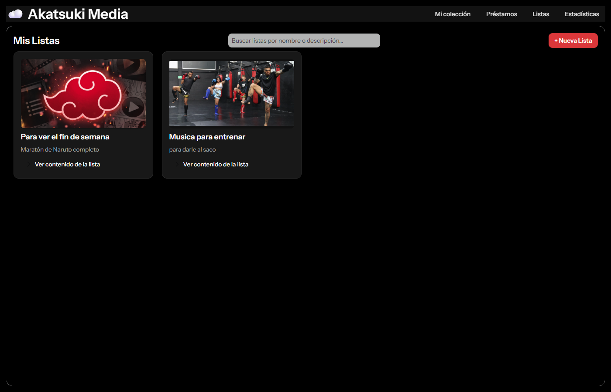

**Crear una lista**
1. Dar clic en **+ Nueva Lista**.
2. Escribir el nombre y (opcional) una descripción.
3. Escoger uno o varios elementos de la colección, de cualquier tipo.
4. (Opcional) Subir una portada. Si no se sube, se le pone la portada por defecto.
5. Dar clic en **Guardar Lista**.

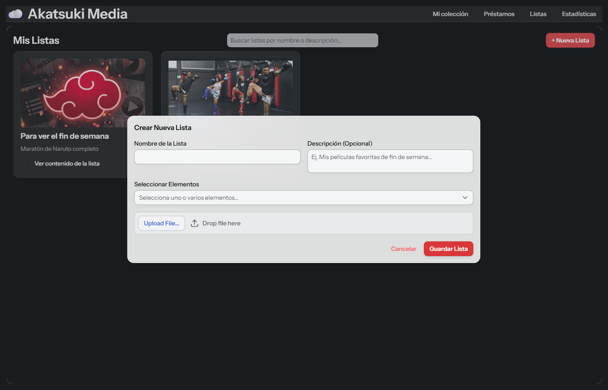

**Manejar el contenido de una lista**
- En **Ver contenido de la lista** se ven los elementos que tiene.
- Con la **✕** se quita un elemento de la lista (pide confirmación). El elemento no se borra de la colección.
- Con el selector y el botón **+ Añadir** se pueden agregar más elementos a la vez.
- **Editar Lista** permite cambiar el nombre, la descripción y la portada.
- **Eliminar Lista** pide confirmación y borra la lista, pero los elementos siguen en la colección.

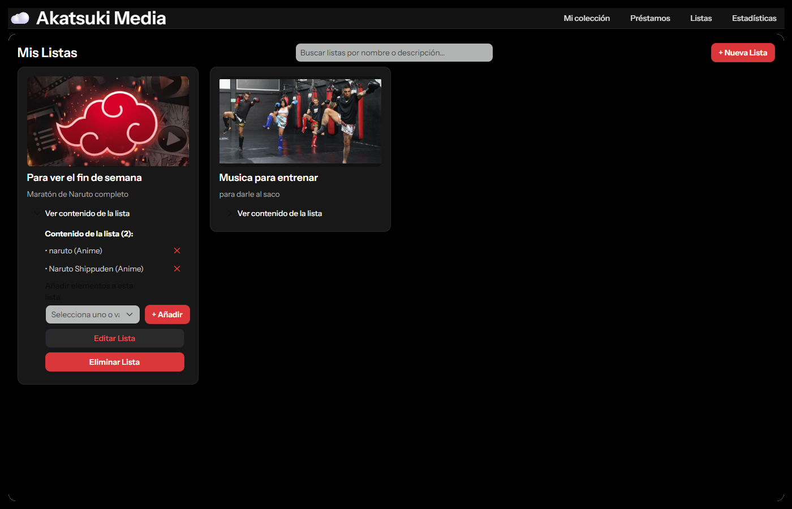
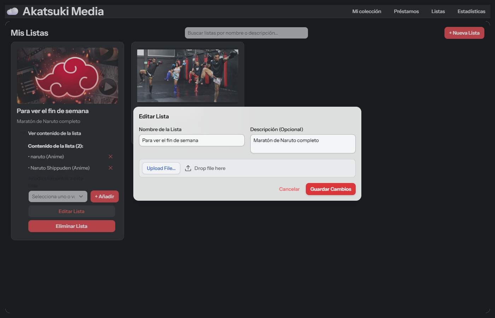

### 4. Estadísticas
Muestra un resumen de la colección: los totales, la calificación promedio, la distribución por tipo, cuántos elementos hay en cada estado, el top 3 de géneros (con **Ver todos los géneros** para ver el resto) y el top 5 de los mejor calificados.

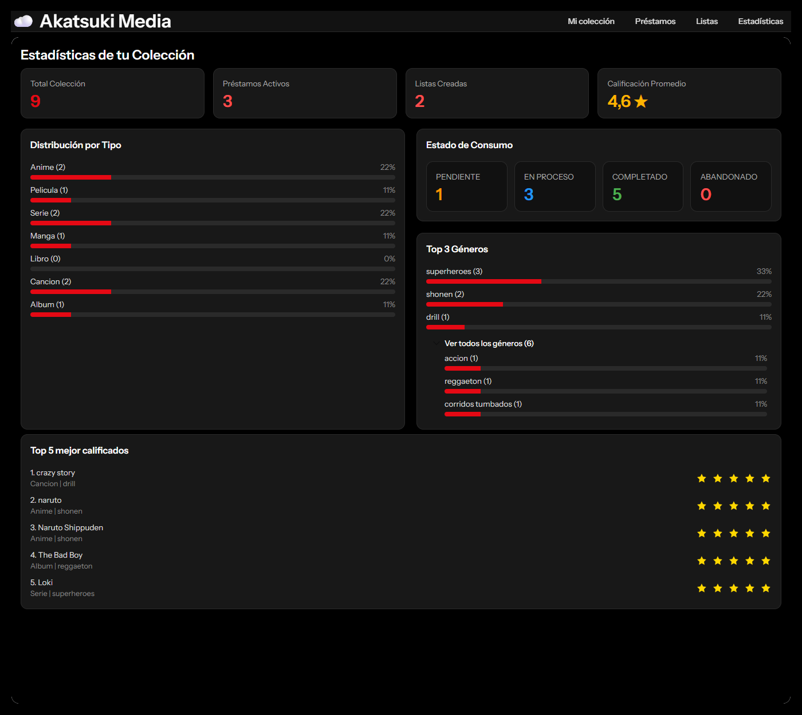

### Validaciones
La aplicación avisa con un mensaje cuando:
- Hay campos obligatorios vacíos.
- Algún texto tiene el carácter `|` (porque es el que separa los datos en los archivos).
- El año no está entre 1800 y el año actual.
- No se le puso calificación al elemento.
- La portada no es JPG o PNG, o pesa más de 2 MB.
- Se intenta prestar un elemento que ya está prestado.
- La fecha de devolución es anterior a la fecha del préstamo.
- Se intenta añadir a una lista elementos que ya están en ella.

### Versión en celular
La aplicación se adapta a pantallas pequeñas: el menú y la barra de búsqueda se acomodan y las tarjetas quedan una debajo de otra.

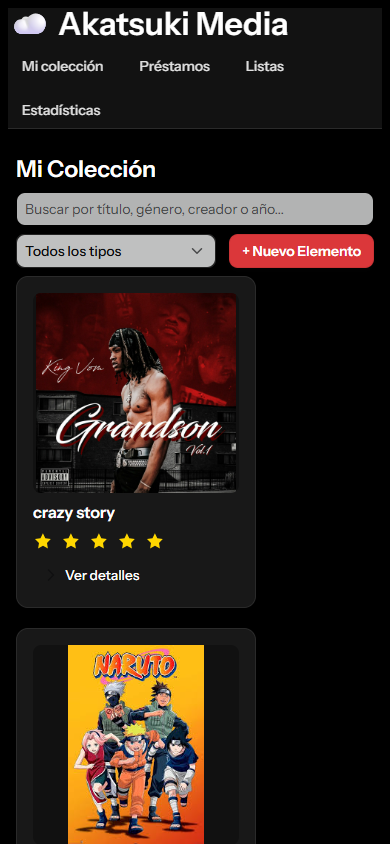

## Tecnologías usadas
- **Java 25**: lenguaje de programación.
- **Vaadin 25.3.3**: para la interfaz web (vistas, formularios, diálogos, notificaciones, subida de imágenes), hecha toda en Java.
- **Spring Boot 4.1.1**: para arrancar la aplicación y el servidor web.
- **Maven** (con Maven Wrapper): para manejar las dependencias y ejecutar el proyecto.
- **Archivos `.txt`** separados por `|`: para guardar los elementos, préstamos y listas.
- **Git y GitHub**: para el control de versiones.
- **Visual Studio Code**: como editor.

## Autor
- **Nombre:** Pablo Pareja Duque
- **Curso:** Lógica de Programación, Universidad Pontificia Bolivariana
- **Fecha:** 11 de noviembre de 2026

## Cómo probar el bono (portadas)
1. En **Mi colección**, dar clic en **+ Nuevo Elemento**, llenar los datos y subir una imagen **JPG o PNG de máximo 2 MB**. Al guardar, la tarjeta muestra la miniatura de la portada.
2. Dar clic sobre la portada para verla en grande.
3. Intentar subir un archivo de más de 2 MB o que no sea imagen: la aplicación no lo deja subir y muestra un mensaje.
4. Revisar la carpeta `coleccion-multimedia/portadas`: la imagen se guarda con un nombre único (un número al inicio + el nombre original), así que dos imágenes con el mismo nombre no se pisan.
5. Eliminar el elemento y revisar otra vez la carpeta `portadas`: la imagen también se borra.
6. Las listas también permiten subir su propia portada de la misma forma.
